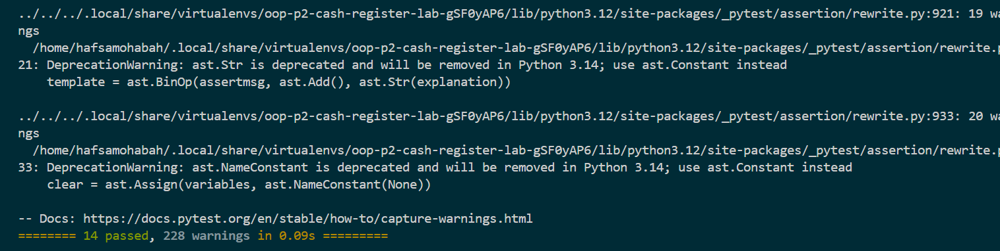

# Cash Register

## Overview

This project implements a simple cash register using Python classes. It simulates basic checkout operations, including adding items, calculating totals, applying percentage discounts, and voiding the most recent transaction.

## Features

- Initialize a cash register with an optional discount.
- Validate discounts as integers between 0 and 100.
- Add items with prices and optional quantities.
- Track the running total and purchased items.
- Store transaction details in `previous_transactions`.
- Apply a percentage discount to the total.
- Void the most recent transaction and update the total and items.
- Display messages when a discount cannot be applied or there is no transaction to void.

## Project Structure

```text
lib/
    cash_register.py
    testing/
        cash_register_test.py
screenshots/
    tests-passed.png
```

## Requirements

- Python
- Pipenv
- Pytest

## Setup

Clone your repository and navigate to the project directory. Install the project dependencies:

```bash
pipenv install --ignore-pipfile
```

## Run the Tests

Run the provided test suite:

```bash
pipenv run pytest -x lib/testing/cash_register_test.py
```

## Example Usage

```python
from lib.cash_register import CashRegister

register = CashRegister(discount=20)
register.add_item("Notebook", 500, quantity=2)
register.add_item("Pen", 100)

print(register.total)  # 1100
print(register.items)  # ['Notebook', 'Notebook', 'Pen']

register.apply_discount()
# After the discount, the total comes to $880.
```

## Test Results

The provided test suite passed all 14 tests.



## Author

Hafsa Mohammed
